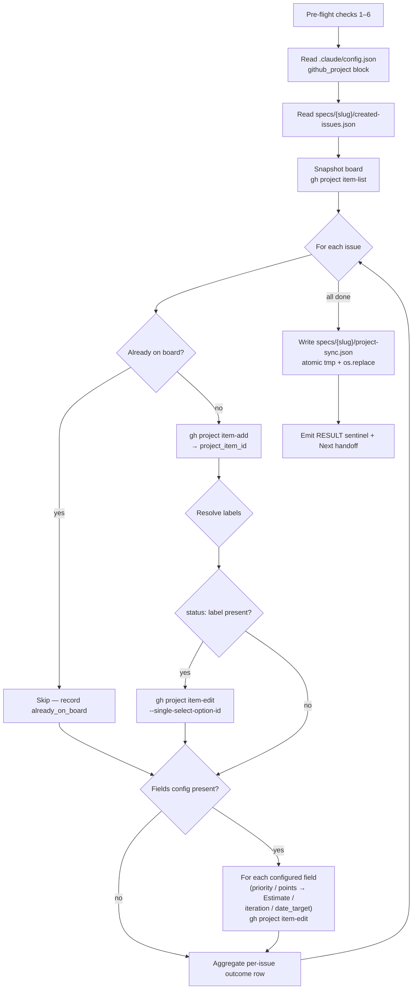

# issue-to-project

Sync GitHub issues to a **GitHub Projects v2** board — read `created-issues.json` from a `to-issues` run, snapshot the board, add anything new, and write status/priority/iteration/estimate/date fields based on the issue's labels. Idempotent: re-running on the same input is safe and a no-op for items already in their target state.

**Owner:** makato-plan plugin
**Status:** stable (v2.7.x)
**Authoritative spec:** [`SKILL.md`](./SKILL.md) — read first when changing the skill.

## What this is for

The natural successor to `/makato-plan:to-issues`. Once `to-issues` has filed issues on github.com and emitted `specs/{slug}/created-issues.json`, this skill lands those issues on a Projects v2 board with the right column and field values, then writes a machine-readable audit at `specs/{slug}/project-sync.json` so downstream automation can verify what happened.

It is **not** a generic Projects-v2 client. The contract is one-way: `created-issues.json` is the source of truth, the board reflects it. The skill never removes board items and never overwrites a Status that was changed externally — labels drive the board, not the other way around.

## When to invoke

| Situation | Command |
| --- | --- |
| First time setting up a repo against a board | `/makato-plan:issue-to-project --init` |
| Just ran `/makato-plan:to-issues <slug>` and want it on the board | `/makato-plan:issue-to-project <slug>` |
| PR opened/merged and you want the column to advance | `/makato-plan:issue-to-project sync-lifecycle <slug>` |
| Operator hand-edited labels (e.g. added `status:blocked`) and you want the board to catch up | `/makato-plan:issue-to-project reconcile <slug> --repair-aggressive` |
| Backfill new field values (Priority, Iteration, etc.) on issues already on the board | `/makato-plan:issue-to-project --fields-only <slug>` |
| Driven from a GitHub Actions webhook | `/makato-plan:issue-to-project --from-webhook <path-to-event.json>` |

## The process (high level)

Six numbered pre-flight checks gate the run (`gh` binary, auth, version, `project` OAuth scope, board ID freshness, GHES version when enterprise). Failure on any check exits 1 with a HALT code. The snapshot is taken once, so re-running on a non-trivial batch is one `item-list` + one mutation per new item — fast and rate-limit-friendly.

For the full step-by-step (exact `gh` invocations, outcome routing tables, error handling, HALT codes), read [`references/sync-process.md`](./references/sync-process.md). Every sub-mode (init, retry, lifecycle, webhook, reconcile, board-audit, fields-only) has its own reference file in `references/`.

## Labels this skill cares about

The skill reads `labels[]` from `created-issues.json` and routes accordingly. It **never** queries live GitHub labels — `to-issues` is the only label source. Five label families are recognized in v2.7+:

### 1. `status:*` — column on the board

| Label | Status column written | Notes |
| --- | --- | --- |
| `status:todo` | `Todo` | Explicit no-op (records distinct outcome from "no label") |
| `status:ready` | `Ready` | Requires `options.ready` in config — absent → falls back to `Todo` with WARN |
| `status:in-progress` | `In Progress` | Auto-set by `sync-lifecycle` when a linked PR opens |
| `status:in-review` | `In review` | Auto-set by `sync-lifecycle` when a PR moves to review |
| `status:blocked` | `Blocked` | The only `status:*` `to-issues` auto-emits at creation time |
| `status:done` | `Done` | Auto-set by `sync-lifecycle` when a PR merges |
| _(none)_ | `Todo` | Project default; in `ready_queue_mode: "autonomous"` may auto-promote to `Ready` |
| Unknown `status:*` | `Todo` | Loud WARN, falls through to default, never aborts |
| Multi-label collision | Priority winner | Order: `blocked > done > in-review > in-progress > ready > todo` |

### 2. `priority:*` — Priority field on the board

`priority:p0..p3` is consumed verbatim by the skill's `signal_prefix: "priority"` resolver (see `references/field-type-routing.md`) and written into the Project board's Priority single-select field. Sourced from `stories[].metadata.priority` by `to-issues` v3.3.0+, or derived from `severity` via `critical→p0`, `high→p1`, `medium→p2`, `low→p3`.

| Label | Priority option written | Short meaning |
| --- | --- | --- |
| `priority:p0` | `P0` | Top urgency — must fix |
| `priority:p1` | `P1` | High — sooner than later |
| `priority:p2` | `P2` | Medium — when capacity allows |
| `priority:p3` | `P3` | Low — backlog |

### 3. `points:*` — Estimate field on the board *(v2.4+ resolver, v3.4.0+ upstream emission)*

`points:<n>` is consumed verbatim by the skill's number-field resolver and written into the Project board's Estimate number field. Sourced from `stories[].metadata.points` by `to-issues` v3.4.0+, or derived from `effort` via SIZE_MAP (`s→1`, `m→3`, `l→8`, `xl→13`). Deprecated `size:S/M/L/XL` labels are still accepted as fallback for the same SIZE_MAP conversion.

| Label | Estimate number written | Short meaning |
| --- | --- | --- |
| `points:1` | `1` | Tiny / cleanup |
| `points:3` | `3` | Small story (≈ 1–3 days) |
| `points:5` | `5` | Mid-sized |
| `points:8` | `8` | Larger story (≈ 3–5 days) |
| `points:13` | `13` | Big — consider re-decomposing |
| `points:21` | `21` | Spike-worthy; usually a decomposition smell |

### 4. `severity:*` and `phase:*` and `effort:*` — read-only metadata

These three families are emitted by `to-issues` v3.3.0+ from `stories[].metadata` but are **not consumed by `issue-to-project`** — they exist for filtering on the Issues page and for human readers scanning the issue body. The board's Priority field comes from `priority:*` only; the Estimate field comes from `points:*` only.

| Label family | Values | Short meaning |
| --- | --- | --- |
| `severity:*` | `critical / high / medium / low` | Operational urgency (intrinsic to the issue) |
| `phase:*` | `1 / 2 / 3 / 4 / 5` | Execution order in the larger plan (lower = earlier; bare digits — never `p<n>`) |
| `effort:*` | `s / m / l / xl` | T-shirt sizing (S = <1 day, XL = >1 week) — human-readable companion to `points:*` |

> **Naming rule:** `phase:*` uses bare digits, `priority:*` uses `p<n>`, `points:*` uses bare positive integers, `effort:*` uses lowercase letters. The four cannot overlap so a reader scanning a board chip or issue body always knows which axis a value belongs to.

### 5. Optional fields (v2.4+) — Iteration / Date Target

When `github_project.fields.{iteration,date_target}` is configured, the skill resolves these from labels too (Estimate is now covered by `points:*` above):

| Field | Signal | Source label / value |
| --- | --- | --- |
| Iteration | first `iter:*` label OR `milestone.title` | e.g. `iter:sprint-31` |
| Date Target | `milestone.due_on` | ISO-8601 date from the issue's milestone |

See [`references/field-type-routing.md`](./references/field-type-routing.md) for the per-type write call reference and the full signal-resolution rules.

## Output

| Artifact | Path | Purpose |
| --- | --- | --- |
| Audit | `specs/<slug>/project-sync.json` | One row per issue: outcome, `project_item_id`, `final_status`, `fields[]`, `needs_status_retry`. Schema in [`references/project-sync.schema.json`](./references/project-sync.schema.json). |
| RESULT sentinel | stdout, second-to-last line | Single-line JSON for orchestrator parsing. Shape varies by mode (normal-run / sync-lifecycle / reconcile / webhook / board-audit). |
| HALT code | stdout, last line on non-zero exit | One of ~25 documented codes (`PREFLIGHT_FAILED`, `STALE_CONFIG`, `RATE_LIMIT_EXCEEDED`, etc. — see SKILL.md). |

## Idempotency guarantees

Two hard rules govern re-runs:

1. **Never remove an item from the board.** v2 only adds or status-edits.
2. **Never overwrite a Status that was changed externally.** Re-runs check the current board status; items not at the skill-expected value are recorded as `lifecycle_skipped_externally_set` and untouched.

A `--repair-aggressive` reconcile run is the only mode that overrides rule 2 — and it requires interactive `yes` confirmation on a TTY, or `--yes-i-know` on a non-TTY.

## Failures and recovery

| Symptom | First check | Recovery |
| --- | --- | --- |
| `HALT: PREFLIGHT_FAILED` | `gh auth status` | Follow the HALT message. Missing `project` scope: run `gh auth refresh --hostname <host> --scopes project,read:project` (`--hostname` is required outside an interactive terminal), then approve the one-time code at `https://<host>/login/device` within 15 minutes |
| `HALT: STALE_CONFIG` | Project archived/deleted/renamed? | Re-run `--init`. v2.5+ supports `--auto-reinit` opt-in. |
| `needs_status_retry: true` rows in artifact | `item-add` succeeded but `item-edit` failed | Run `--retry-blocked-edits <slug>` |
| `HALT: RATE_LIMIT_EXCEEDED` | GitHub returned 429 | Wait for the `Retry-After` window and re-run |
| `HALT: TLS_TRUST_FAILED` (GHES only) | Self-signed CA | Install CA in system trust store — the skill does **not** weaken TLS |

Full recovery procedures live in `references/retry-process.md`, `references/auto-reinit-process.md`, and the SKILL.md "Idempotency contract" section.

## NEVERs (the short list)

- **Never** use `GH_ENTERPRISE_TOKEN` — authenticate via `gh auth login --hostname <host>` (the env var is incompatible with the `project` OAuth scope).
- **Never** call `gh project view` on every run to validate cached IDs — that defeats caching. The exception is the deliberate one-shot verify-on-first-call probe (skippable via `ITP_SKIP_VERIFY=1`).
- **Never** query labels live from GitHub — `created-issues.json` is the only label source for routing decisions.
- **Never** prompt the user in normal-run — only `--init` and `--repair-aggressive` are interactive.

## Configuration

Per-repo config lives in `.claude/config.json` → `github_project`. Required keys: `owner`, `owner_type`, `number`, `url`, `project_node_id`, `status_field_id`, `options.{todo,in_progress,done,blocked}`. Optional v2.7 keys: `options.{ready,in_review}`, `ready_queue_mode`, `pr_label_name`. Optional v2.4+ keys: `fields.{priority,estimate,iteration,date_target}` — each carries the live field `id` (discovered via `gh project field-list` during `--init`) and a `type` of `single-select`, `number`, `iteration`, or `date`. Full contract in [`references/config-schema.md`](./references/config-schema.md).

`--init` writes this block interactively. If a v1-shape config is found (flat `status_field_id` / `options.*` keys), v2.4 translates it in-memory and prints a deprecation WARN — re-run `--init` to migrate to disk.

## Related skills

- **`/makato-plan:to-issues`** — produces the `created-issues.json` this skill consumes. Owns the label taxonomy (10 dimensions in v3.4.0+).
- **`/makato-plan:decompose`** — earlier in the chain; produces `stories.json` with the `metadata` block that becomes the prioritization labels.
- **`/makato-build:build-create-pr`** — opens the PR that `sync-lifecycle` later sees and advances the board column for.

## See also

- [`SKILL.md`](./SKILL.md) — authoritative behavior spec, argv contract, exit codes, HALT taxonomy.
- [`references/`](./references/) — one reference file per sub-mode + per schema.
- [`../../CHANGELOG.md`](../../CHANGELOG.md) — version history (search for `issue-to-project skill`).
