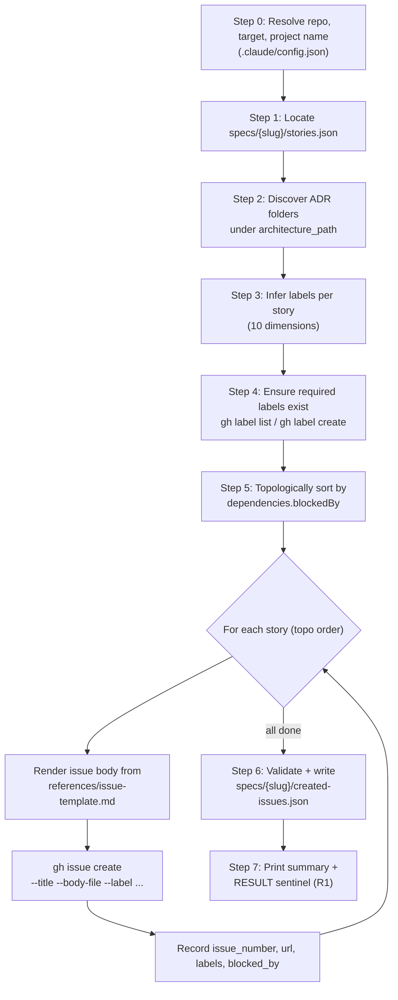

# to-issues

Convert a shaped `stories.json` into real GitHub issues on github.com — apply a 10-dimension label taxonomy, render bodies from a versioned template, sort topologically by `blockedBy`, and emit `specs/{slug}/created-issues.json` as a machine-readable handoff for `issue-to-project` and `build-create-pr`.

**Owner:** makato-plan plugin
**Status:** stable (v3.5.0)
**Authoritative spec:** [`SKILL.md`](./SKILL.md) — read first when changing the skill.

## What this is for

The final step of the planning phase. After `decompose` produces `stories.json`, this skill files one GitHub issue per story with the right labels and a body that explains the work, the acceptance criteria, and the dependency graph. Downstream skills (`issue-to-project`, `build-create-pr`) consume the `created-issues.json` artifact and never touch the issue list directly.

The label taxonomy is the contract: 10 dimensions, each emitted as `dimension:value`. Three of them drive the GitHub Project board automatically (`status:*` → column, `priority:*` → Priority field, `points:*` → Estimate number field); the rest are for filtering and human readers.

## When to invoke

| Situation | Command |
| --- | --- |
| `decompose` just emitted `stories.json` and you want issues filed | `/makato-plan:to-issues <slug>` |
| Want to preview what would be created without touching GitHub | `DRY_RUN=1 /makato-plan:to-issues <slug>` |
| Running headlessly in a workflow (no prompts) | `/makato-plan:to-issues <slug> --autonomous` |
| Interactive review of each story's inferred labels | `/makato-plan:to-issues <slug> --interactive` (the default) |

## The process (high level)



Stories are processed in topological order so that by the time a downstream story is created, its upstream `blockedBy` issues already have real GitHub issue numbers. Partial failures stop the batch immediately and persist whatever was successfully created — re-run with the remaining stories in `stories.json`. Full step-by-step details (exact `gh` invocations, inference algorithms, error handling) live in [`SKILL.md`](./SKILL.md).

## The 10 label dimensions

Every issue carries one label from each applicable dimension. Five are always-resolved (when a value exists); the rest are sparse — emitted only when conditions warrant. The full inference algorithm is in [`references/label-taxonomy.md`](./references/label-taxonomy.md).

### Always-resolved (when value exists)

| Dimension | Source | Examples | Short meaning |
| --- | --- | --- | --- |
| `type:*` | Regex-match story `summary` + `description.scope` + `description.background` against the inference table | `type:feat`, `type:fix`, `type:docs`, `type:refactor`, `type:test`, `type:chore`, `type:future-enhancement` | What kind of work — drives filtering and changelog grouping |
| `tier:*` | `stories[].phase` verbatim (skipped for `type:future-enhancement`) | `tier:foundation`, `tier:happy-path`, `tier:edge-cases` | Vertical-slice position in this feature |
| `tech:*` | Default keyword map + `.claude/config.json` `labels.tech` extensions | `tech:python`, `tech:bash`, `tech:skill`, `tech:harness` | What stack the work touches (multi-valued) |
| `module:*` | ADR folder-name match against story tokens (language-neutral document-frequency filter drops batch-universal connectives) | `module:to-issues`, `module:billing` | Which architecture module the work lands in |

### Prioritization (resolved from `stories[].labels[]` → `storyPoints` → legacy `metadata`, v3.3.0+)

| Dimension | Source (precedence: explicit `labels[]` → legacy `metadata` → derivation) | Examples | Short meaning |
| --- | --- | --- | --- |
| `severity:*` | `labels[]` `severity:*` → `metadata.severity` | `severity:critical`, `severity:high`, `severity:medium`, `severity:low` | Operational urgency, intrinsic to the issue |
| `phase:*` | `labels[]` `phase:*` → `metadata.phase` (bare digits, **never** `p<n>` — that prefix is reserved for priority; never derived from `stories[].phase`) | `phase:1`, `phase:2`, ..., `phase:5` | Execution order across the plan (lower = earlier) |
| `effort:*` | `labels[]` `effort:*` → `metadata.effort` | `effort:s`, `effort:m`, `effort:l`, `effort:xl` | T-shirt sizing (S = <1 day, XL = >1 week) |
| `priority:*` | `labels[]` `priority:*` → `metadata.priority` → derived from severity → derived from tier | `priority:p0`, `priority:p1`, `priority:p2`, `priority:p3` | Board-display priority — consumed by `issue-to-project` for the Priority single-select field |
| `points:*` *(v3.4.0+)* | `labels[]` `points:*` → `metadata.points` → derived from `storyPoints` → derived from effort | `points:1`, `points:3`, `points:8`, `points:13` | Story-point estimate — consumed by `issue-to-project` for the Estimate number field |

### Derivation chains (when no explicit `labels[]`/legacy value)

```
severity → priority:*
  critical  → priority:p0
  high      → priority:p1
  medium    → priority:p2
  low       → priority:p3

tier → priority:*   (v3.7.0+, fallback when no severity resolved)
  foundation  → priority:p0
  happy-path  → priority:p1
  edge-cases  → priority:p3
  (p2 intentionally unmapped — reserve for explicit operator assignment)

storyPoints → points:*   (v3.5.0+, primary path for v2.0 stories.json)
  points:<storyPoints>   (verbatim positive integer)

effort → points:* (SIZE_MAP, fallback when storyPoints absent)
  s   → points:1
  m   → points:3
  l   → points:8
  xl  → points:13
```

Explicit values always win silently — operator intent is the source of truth. The derivation log line appears in autonomous mode: `[to-issues:auto] story <n>: priority:p0 derived from severity:critical`.

### Sparse

| Dimension | When emitted | Examples |
| --- | --- | --- |
| `status:*` | Only when status is non-default — `dependencies.blockedBy` has unresolved IDs, OR `type:future-enhancement` was inferred, OR explicit `stories[].labels` contains a `status:*` | `status:blocked` (the only `status:*` auto-emitted at creation time) |

`status:in-progress` / `status:done` / `status:ready` / `status:in-review` are taxonomy values but **never** auto-emitted by this skill — lifecycle transitions belong to `issue-to-project sync-lifecycle`.

## Naming rule (collision-free by construction)

The four prioritization dimensions use disjoint value namespaces so a reader scanning a board chip or issue body always knows which axis a value belongs to:

| Family | Value shape | Example |
| --- | --- | --- |
| `phase:*` | bare digit | `phase:1` |
| `priority:*` | `p<n>` | `priority:p0` |
| `points:*` | bare positive integer | `points:3` |
| `effort:*` | lowercase letter(s) | `effort:m` |

Never `phase:p1` (that would collide with `priority:p1`). The skill auto-normalizes a `metadata.phase: "p1"` input to `"1"` with a soft-warn for backward compatibility.

## Input

```json
{
  "version": "1.0",
  "slug": "my-feature",
  "stories": [
    {
      "sequence": 1,
      "phase": "foundation",
      "summary": "[component] feat: walking-skeleton outcome",
      "storyPoints": 3,
      "labels": [],
      "metadata": {
        "severity": "critical",
        "phase":    "1",
        "effort":   "m"
      },
      "description": {
        "background": "…",
        "scope":      "…",
        "successScenarios": [{"title": "Scenario 1", "given": "…", "when": "…", "then": "…"}],
        "outOfScope": []
      },
      "definitionOfDone": ["…"],
      "dependencies": { "blockedBy": [], "blocks": [] }
    }
  ]
}
```

`metadata` is optional. Without it, the 5 prioritization labels are simply omitted — issues still get created with type/tier/tech/module/status. Full schema lives in the `decompose` skill's [`references/stories-json-schema.md`](../decompose/references/stories-json-schema.md).

## Output

| Artifact | Path | Purpose |
| --- | --- | --- |
| GitHub issues | `https://github.com/<owner>/<repo>/issues/<n>` | One per story, with title `[<project>] <story-title>`, body rendered from [`references/issue-template.md`](./references/issue-template.md), and the inferred label set |
| Handoff | `specs/<slug>/created-issues.json` | Machine-readable: `issue_number`, `url`, `title`, `labels`, `blocked_by` per issue. Schema in [`references/created-issues.schema.json`](./references/created-issues.schema.json) |
| Repo labels | `gh label list --repo <target>` | Created on demand using the colors documented in [`references/label-taxonomy.md`](./references/label-taxonomy.md) — never overwrites existing label colors |
| RESULT sentinel | stdout (R1 JSON) | `{ "status": "COMPLETED" \| "PARTIAL" \| "FAILED", "issues_created": N, "artifact_path": "…", "dry_run": bool }` |

## Failures and recovery

| Symptom | First check | Recovery |
| --- | --- | --- |
| `HALT: MISSING_INPUT` | No `stories.json` at the resolved slug | Re-run `/makato-plan:decompose` or pass a different slug |
| `HALT: MALFORMED_CONFIG` | `.claude/config.json` invalid JSON | Fix syntax — the skill never silently falls back |
| `HALT: GH_AUTH_FAILED` | `gh auth status` | `gh auth login --hostname github.com --scopes repo,project` |
| `HALT: PARTIAL_FAILURE` | Mid-batch `gh issue create` failure | Inspect `created-issues.json` (partial), trim already-created entries from `stories.json`, re-run with the remainder |
| `HALT: SCHEMA_VALIDATION_FAILED` | Generated `created-issues.json` failed schema | Skill bug — file an issue with the validation error |

DRY_RUN protection: setting `DRY_RUN=1` skips every `gh issue create` call, assigns synthetic sequential numbers, and writes a byte-equivalent artifact apart from `issue_number` and `url`. Safe to run against a stale `stories.json`.

## NEVERs (the short list)

- **Never** target a 2.x enterprise GitHub host — `GH_HOST` MUST be `github.com`. `GH_ENTERPRISE_TOKEN` is incompatible with the `project` OAuth scope and not used by this skill.
- **Never** read ADR file contents for module matching — folder names only. The skill matches story tokens against folder slugs; nothing more.
- **Never** prompt in `--autonomous` mode. All inference decisions apply silently with one log line per decision prefixed `[to-issues:auto]`.
- **Never** invent stories that aren't in `stories.json` — empty input produces an empty artifact (`{schema_version: "1", slug, issues: []}`) and exits 0.
- **Never** overwrite existing label colors — `gh label create` is no-op-on-existing.

## Configuration

`.claude/config.json` at the repo root drives behavior:

| Key | Purpose | Required? |
| --- | --- | --- |
| `project` | Title prefix on every issue: `[<project>] <story-title>` | Yes (fallback `"sagibeast"`) |
| `architecture_path` | Where ADR folders live, for `module:*` matching | No (defaults `specs/Architecture`) |
| `labels.tech` | Extension entries appended to the default tech keyword map | No (union-with-defaults; default wins on label-name collision) |
| `labels.modules` | Extension entries for `module:*` keyword matching | No |

Full contract lives in [`references/label-taxonomy.md`](./references/label-taxonomy.md) under "Config-Extension Contract (D14)".

## Related skills

- **`/makato-plan:decompose`** — produces the `stories.json` this skill consumes. The `metadata` block on each story is where severity/phase/effort/priority/points come from.
- **`/makato-plan:issue-to-project`** — the natural successor. Reads `created-issues.json`, lands issues on a GitHub Projects v2 board, writes Priority and Estimate fields from `priority:*` and `points:*` labels.
- **`/makato-build:build-create-pr`** — opens a PR for implementation work and auto-injects `Closes #N` lines from `created-issues.json`.

## See also

- [`SKILL.md`](./SKILL.md) — authoritative behavior spec, argv contract, partial-failure semantics, HALT taxonomy.
- [`references/label-taxonomy.md`](./references/label-taxonomy.md) — the 10 dimensions in detail, type-inference regex table, derivation maps, GitHub-label colors.
- [`references/issue-template.md`](./references/issue-template.md) — issue body template; edit here to change body format for every issue going forward.
- [`references/slice-patterns.md`](./references/slice-patterns.md) — load only when a slice boundary is ambiguous.
- [`../../CHANGELOG.md`](../../CHANGELOG.md) — version history (search for `to-issues skill`).
